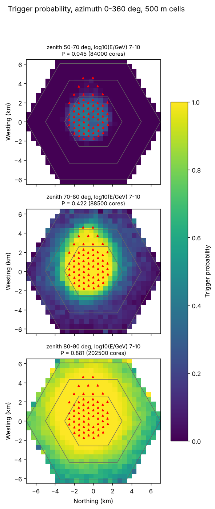
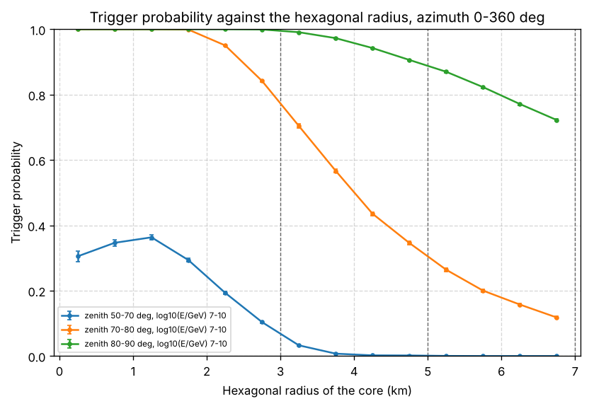

# Hexagon rings and trigger-probability maps: an example

This folder runs the stage-4 tools for rings of the hexagon on the showers of the Dummy library (250 showers, Xmax from the dummy parameterisation, so no shower simulation is needed). It takes about two minutes.

Drawn uniformly over the whole hexagon, most cores fall around the array, where the trigger probability is high, and few in the outskirts. Here the 7 km hexagon is split into three rings, each simulated as its own library with 500 cores per shower, and the rings are then combined into one library with the right weights. See the README of `4-DC3EventGenerator` for how it works.

| File | Ring | `hex_inner` | `hex_size` | `EventSeed` |
|---|---|---|---|---|
| `Ring0.ini` | 0 to 3 km | 0 | 3000 | 41 |
| `Ring1.ini` | 3 to 5 km | 3000 | 5000 | 42 |
| `Ring2.ini` | 5 to 7 km | 5000 | 7000 | 43 |

The three `.ini` files have only an `[EventGenerator]` section: the one of `../Example_dc3_config_Dummy.ini`, with its paths written from this folder, its own `out_db`, and the settings of the table.

## Usage

From this folder:

1. Simulate the three rings (about 20 s each):

```bash
python3 ../../4-DC3EventGenerator/SimpleDC3EventGenerator.py Ring0.ini
python3 ../../4-DC3EventGenerator/SimpleDC3EventGenerator.py Ring1.ini
python3 ../../4-DC3EventGenerator/SimpleDC3EventGenerator.py Ring2.ini
```

They end with 224, 213 and 194 of 250 events triggered, and natural rates of 433304, 316357 and 243552 triggered events per year. The two outer rings also print an `Inner Hexagon` line, with 3000.0 m and 5000.0 m.

2. Combine them into one library:

```bash
python3 ../../4-DC3EventGenerator/CombineHexRings.py Rings.sqlite Ring0.sqlite Ring1.sqlite Ring2.sqlite
```

It ends with `Wrote 'Rings.sqlite': 750 events, 631 of them triggered; natural rate of triggered events 993213 per year.` `Rings.sqlite` has the tables of any EventGenerator database, so stage 5 reads it too.

3. Map the trigger probability of the combined library:

```bash
python3 ../../4-DC3EventGenerator/TriggerProbabilityMap.py Rings.sqlite --zenith 50,70,80,90 --plots Plots
```

It prints, per zenith bin, P = 0.0446, 0.4217 and 0.8809, with the hexagonal radii that hold 50%, 90% and 99% of the triggering cores, writes `Rings_TriggerMap.sqlite`, and saves the map and the radial profile in `Plots`.

4. To compare, the same map of the Dummy library drawn over the whole hexagon (`../ExampleDummyTriggeredEvents.sqlite`):

```bash
python3 ../../4-DC3EventGenerator/TriggerProbabilityMap.py ../ExampleDummyTriggeredEvents.sqlite --zenith 50,70,80,90 --out WholeHexagon_TriggerMap.sqlite --plots PlotsWholeHexagon
```

P = 0.0453, 0.4249 and 0.8817: the same as the rings, within the statistics.

Git ignores what the example writes here (the `.sqlite` files and the `Plots` folders), so you can run it and leave it.

## What it shows

The rings give the outskirts as many events as the centre: 224, 213 and 194 triggered events in the three rings, where the whole hexagon gives 85, 55 and 83 (it has one event per shower, the rings one per shower and ring). Their combination still describes the whole hexagon: per shower, the trigger probability from the rings, weighted by their areas, agrees with the one from the whole hexagon, and so do the maps.

The map of the combined rings, with the ring edges (`ExampleRingsTriggerMap.png`):



The trigger probability against the distance from the centre (`ExampleRingsTriggerProfile.png`):



The profile is the tool for choosing rings. Here, at zenith 50 to 70° nothing triggers beyond about 4 km, while at 80 to 90° the probability is still about 0.7 at the edge of the 7 km hexagon: a library of inclined showers needs rings beyond it.

The trigger here is the geometric one of the Dummy library (Cherenkov cone of 1°, 3 antennas); the same commands work with any trigger stage 4 uses.
